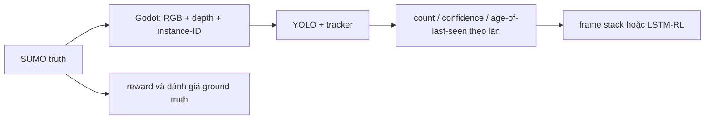

# Phân tích nhiễu có cấu trúc, hình học camera, RL và QUBO

## Kết luận ngắn

Hướng hiện tại có thể mở rộng mà không cần đập bỏ kiến trúc. Tuy nhiên, nhiễu xe bị che khuất phải được xử lý ở lớp camera/sensor dưới dạng **partial observability**, không phải làm hỏng trạng thái giao thông thật của SUMO.

Hiện project chưa đủ để khẳng định xử lý được occlusion quang học thực tế hoặc 160 đèn. Các phần còn thiếu nằm ở pipeline render visibility, thông số chiều cao xe, bộ chuyển đổi sensor → observation, và kiến trúc multi-agent RL.

## 1. Nhiễu che khuất, memory RL và quy mô 160 đèn

Kiến trúc hiện tại đã tách SUMO → trace → Godot/camera → YOLO → RL, nên có thể mở rộng theo hướng này mà không phá lõi.

Tuy nhiên sensor exporter hiện mới là smoke test. Ảnh RGB được tạo từ nền/đường giả, còn nhãn được tạo bằng cách chiếu bounding box của các xe lên ảnh. Pipeline chưa có depth-buffer hoặc kiểm tra vật nào che vật nào. Vì vậy xe con bị bus hoặc truck che hoàn toàn vẫn có thể bị ghi nhãn như đang nhìn thấy.

Các phần liên quan:

- [`run_sensor_dataset_smoke.gd`](C:/Users/admin/Documents/HTVC/ai-quantum-hvtc-challenge/render/scripts/sensors/run_sensor_dataset_smoke.gd:100)
- [`sensor_render_pipeline.gd`](C:/Users/admin/Documents/HTVC/ai-quantum-hvtc-challenge/render/scripts/sensors/sensor_render_pipeline.gd:10)

Pipeline nên tiến tới:



### Điều kiện quang hình học bắt buộc

- Mỗi camera cần pose thực: cao `h`, pitch/yaw/roll, FOV hoặc intrinsics, độ phân giải và vùng quan sát theo làn.
- Render phải xuất RGB thật, depth và instance-ID. Từ đó tính `visible_fraction` cho từng xe.
- Cần quy định rõ khi nào một xe bị che vẫn được gắn nhãn: theo phần nhìn thấy, bbox đầy đủ, hoặc loại khỏi nhãn khi tỷ lệ nhìn thấy quá thấp.
- Nhiễu phải có cấu trúc: phụ thuộc camera, làn, khoảng cách, loại xe, mật độ giao thông và thời gian liên tiếp; không chỉ là dropout hoặc Gaussian độc lập.
- Nên lưu thêm mức che khuất và độ tin cậy để đánh giá sensor, dù các trường này không đưa trực tiếp vào nhãn YOLO chuẩn.

RL không nên nhận ảnh thô ở phiên bản đầu. Nên chuyển đầu ra YOLO/tracker thành vector theo approach/lane, gồm:

- `count_hat` và tỷ lệ bus/truck/car/motorbike;
- confidence hoặc visible fraction;
- thời gian kể từ lần quan sát gần nhất;
- biến động trong cửa sổ 5–15 giây;
- cờ “quan sát không chắc chắn”.

### Frame stack và recurrent policy

Model hiện tại dùng `PPO("MlpPolicy", ...)` và environment được tạo với `single_agent=True`:

- [`rl_sumo_train.py`](C:/Users/admin/Documents/HTVC/ai-quantum-hvtc-challenge/scripts/training/rl_sumo_train.py:170)
- [`rl_sumo_train.py`](C:/Users/admin/Documents/HTVC/ai-quantum-hvtc-challenge/scripts/training/rl_sumo_train.py:183)

Do đó hiện chưa có LSTM/GRU, recurrent policy hoặc frame stack trong code train. Dependency hiện chỉ có Stable-Baselines3, chưa có `sb3-contrib`, nên RecurrentPPO chưa được project hỗ trợ sẵn.

Khuyến nghị:

1. Bắt đầu với YOLO + tracker + 4–8 cửa sổ đặc trưng lịch sử.
2. Benchmark queue/count error và reward trước/sau frame stack.
3. Chỉ thêm RecurrentPPO/LSTM nếu frame stack và tracker chưa đủ.

Với RL signal-control, tracker thường xử lý tốt các đoạn che khuất ngắn hơn việc bắt MLP tự nhớ toàn bộ ảnh.

### Quy mô 160 đèn

Model hiện tại chưa đủ để khẳng định chạy ổn ở 160 đèn. Project hiện nói tới technical district 16 nút và demo target khoảng 12–25 nút:

- [`SUMO_RL_SYSTEM_DESIGN.md`](C:/Users/admin/Documents/HTVC/ai-quantum-hvtc-challenge/docs/02_ARCHITECTURE/SUMO_RL_SYSTEM_DESIGN.md:97)

Ở quy mô 160 nên dùng:

- multi-agent RL;
- policy sharing giữa các đèn có cùng loại hình;
- observation cục bộ theo approach và tóm tắt hàng xóm;
- centralised critic hoặc graph neural network;
- recurrent state nếu quan sát camera là nguồn chính.

Không nên tạo 160 PPO độc lập, cũng không nên ghép toàn bộ action thành một action phẳng duy nhất.

## 2. Project đã có chiều cao vehicle trong SUMO chưa?

### Đã có

Project đã có `length_m` và `width_m` theo loại xe. Ví dụ bus và heavy truck có mặc định dài khoảng 12 m, rộng 2.5 m. Các giá trị này được đưa vào SUMO `vType`:

- [`models.py`](C:/Users/admin/Documents/HTVC/ai-quantum-hvtc-challenge/ai_quantum_hvtc/simulation/domain/models.py:59)
- [`exporter.py`](C:/Users/admin/Documents/HTVC/ai-quantum-hvtc-challenge/ai_quantum_hvtc/simulation/engines/sumo/exporter.py:107)

### Chưa có

Chưa có hợp đồng vật lý chuẩn cho:

- `height_m` hoặc roof height theo vehicle type;
- cao độ `z` của xe trong trace;
- cao độ mặt đường hoặc đường vượt;
- liên kết chuẩn giữa kích thước SUMO và kích thước mesh Godot.

`body_height` trong Godot hiện chủ yếu là độ nâng node khi render, không phải chiều cao vật lý của xe. Hàm `sumo_to_world` cũng chỉ nhận `x`, `y` và một giá trị height render:

- [`vehicle_base.gd`](C:/Users/admin/Documents/HTVC/ai-quantum-hvtc-challenge/render/scripts/replay/vehicle_base.gd:69)
- [`coordinate_mapper.gd`](C:/Users/admin/Documents/HTVC/ai-quantum-hvtc-challenge/render/scripts/replay/coordinate_mapper.gd:17)

Trace FCD hiện chỉ đưa vào `vehicle_id`, `vehicle_type`, `x`, `y`, speed, angle, lane và road; chưa có chiều cao hoặc tọa độ đứng theo trục `z`:

- [`parser.py`](C:/Users/admin/Documents/HTVC/ai-quantum-hvtc-challenge/ai_quantum_hvtc/simulation/engines/sumo/parser.py:308)

Vì vậy hiện chưa thể đảm bảo bus/truck che sedan đúng theo hình học vật lý. Cần bổ sung canonical `length_m`, `width_m`, `height_m`, ground offset và mapping mesh. Nếu mô phỏng cầu/vượt, cần thêm cao độ mặt đường chứ không chỉ chiều cao thân xe.

Camera catalog đã có vị trí, góc và FOV, nhưng chưa có contract hiệu chuẩn bảo đảm các giá trị đó tương ứng vật lý với đường và xe:

- [`CameraRigCatalog.tres`](C:/Users/admin/Documents/HTVC/ai-quantum-hvtc-challenge/render/resources/catalogs/CameraRigCatalog.tres:13)

## 3. Đánh giá hướng hiện tại

Hướng “nhiễu có cấu trúc cho RL, một phần cho YOLO, rồi dùng memory để suy luận xe bị khuất” là hợp lý, nhưng nên thực hiện theo thứ tự:

1. Chuẩn hóa hình học 3D, kích thước vehicle và render visibility.
2. Huấn luyện/evaluate YOLO trên cảnh có occlusion thật, không thêm nhiễu tượng trưng.
3. Đo lỗi YOLO so với SUMO theo camera, mật độ và loại xe.
4. Dùng chính phân phối lỗi đó để train RL robust: clean → mixed → severe occlusion.
5. Thêm tracker và frame stack; chỉ dùng LSTM khi benchmark cho thấy còn thiếu memory.

Không nên kỳ vọng model suy ra chính xác một xe bị che hoàn toàn trong thời gian dài. Mục tiêu phù hợp hơn là model học một belief: có khả năng còn xe phía sau, độ tin cậy bao nhiêu, và chọn pha đèn an toàn/robust hơn khi quan sát thiếu.

Một điểm quan trọng: không nên đưa hidden SUMO truth vào RL khi đang đánh giá camera-based control. Ground truth chỉ dùng cho label, reward và đo sai số; observation của RL phải đi qua sensor adapter.

## 4. QUBO và RL có nên tối ưu liên tục cùng nhau?

Với 160 đèn, số tập đầu tư là:

```text
2^160 ≈ 1.46 × 10^48
```

Vì vậy train full RL riêng cho mọi tổ hợp là không khả thi.

Tuy nhiên chưa nên gộp QUBO và RL thành một mô hình đơn khối cập nhật liên tục ngay từ đầu. Hai quyết định ở hai thang thời gian khác nhau:

- QUBO: chọn đèn nào được đầu tư, là quyết định rời rạc và dài hạn.
- RL: điều khiển pha đèn, là quyết định vận hành lặp lại theo thời gian.

QUBO hiện tại mới dùng giá trị từng candidate cộng với phạt ngân sách. Các hệ số ngoài đường chéo chưa biểu diễn lợi ích hoặc tác hại giao thông thật giữa hai nút; exact solver còn duyệt toàn bộ subset:

- [`investment.py`](C:/Users/admin/Documents/HTVC/ai-quantum-hvtc-challenge/ai_quantum_hvtc/policy/algorithms/investment.py:19)
- [`investment.py`](C:/Users/admin/Documents/HTVC/ai-quantum-hvtc-challenge/ai_quantum_hvtc/policy/algorithms/investment.py:66)

### Hướng nên dùng

Nên dùng tối ưu hai tầng có lặp có kiểm soát:

1. Train một shared/conditional RL policy có biết `upgrade_mask` hoặc trạng thái đèn nào được nâng cấp.
2. Lấy mẫu các subset đại diện, các corridor và nhiều scenario/seed.
3. Đo lợi ích đơn lẻ và tương tác theo cặp/cụm.
4. Đưa các hệ số tương tác vào QUBO.
5. Chọn subset theo ngân sách.
6. Chạy SUMO nhiều seed để xác nhận.
7. Fine-tune policy cho một số subset tốt nhất và lặp tới khi quyết định đầu tư ổn định.

Về mặt khái niệm:

```text
chọn x theo ngân sách
    ↓
train/evaluate policy π khi cấu hình là x
    ↓
ước lượng public value và tương tác mạng
    ↓
cập nhật QUBO
    ↓
chọn x mới
```

Như vậy QUBO và RL vẫn liên kết chặt, nhưng không phải retrain từ đầu cho mọi tổ hợp. Đây là hướng thực tế hơn so với cố ép toàn bộ bài toán thành một vòng tối ưu duy nhất và kỳ vọng hội tụ toàn cục.

## Kết luận cuối

- Có thể xử lý structured occlusion mà không phá kiến trúc hiện tại.
- Cần nâng cấp render từ projected bbox smoke test lên RGB + depth + instance-ID thật.
- Project chưa có `height_m` vật lý chuẩn cho vehicle trong SUMO/domain/trace.
- PPO hiện tại chưa có frame stack, recurrent memory hay multi-agent support cho 160 đèn.
- 160 đèn cần shared multi-agent/GNN/recurrent architecture và nhiều scenario/seed.
- QUBO nên làm tầng lựa chọn đầu tư bên ngoài RL, với hệ số tương tác học từ các lần chạy SUMO; không nên gộp thành một mô hình đơn khối ngay từ đầu.

Phân tích này chỉ đọc repository; không thay đổi mã nguồn hay cấu hình project.
