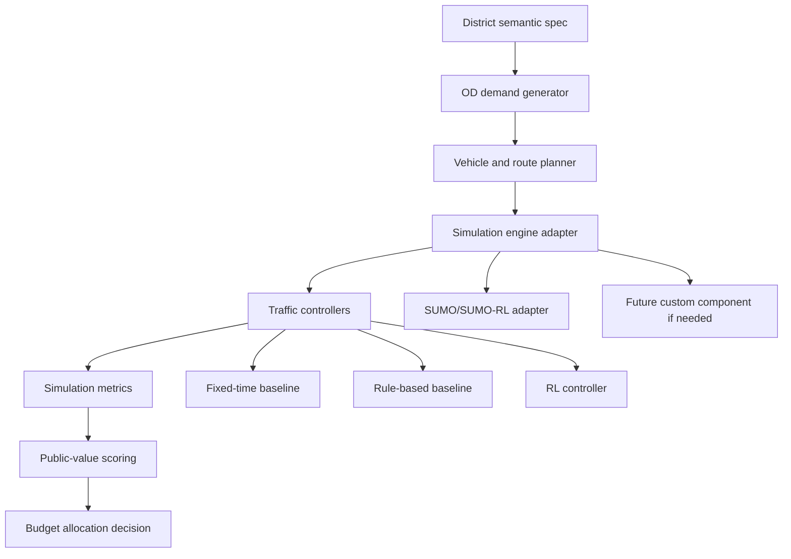

# Public-Service District Environment Spec v1

This document is the first concrete environment architecture for **Smart Traffic Public Finance
Optimization**. It intentionally designs the best project environment first, then maps it to a
simulation engine later.

SUMO/SUMO-RL remains the default implementation target in this repository, but the environment design
must not be weakened just because an engine feature is inconvenient. If a behavior cannot be expressed
cleanly in SUMO, the team may add an engine-independent domain layer, an adapter, or a future custom
component through a new approved task manifest.

## Design principle

The environment is not a place where vehicles randomly wander. Every vehicle should exist because a
person, service, business, or public institution creates a trip.

```text
zone purpose -> trip purpose -> origin/destination -> vehicle type -> route policy
             -> signal control response -> traffic metric -> public-finance decision
```

The RL agent controls traffic signals. It does not invent the city. The city must already contain
meaningful travel demand, road constraints, public-service priorities, and investment tradeoffs.

## Inspiration from the OOP traffic project

The old OOP project should not become the main simulator, but it gives useful domain ideas:

| OOP idea | Keep | Upgrade in this project |
|---|---|---|
| `LocationType`: school, hospital, bar, residential, commercial | Yes | Expand into a richer urban and economic tag system. |
| Road capacity, current vehicle count, congestion, density, status | Yes | Treat as road attributes and output metrics, not only routing internals. |
| Vehicle types: car, bus, emergency | Yes | Add Vietnam-relevant and economy-relevant vehicles. |
| Route preference: shortest distance/time/congestion-aware | Yes | Assign route policies by trip purpose and vehicle type. |
| Events: congestion, accident, closure, traffic-light delay | Yes | Add events that affect public services, industry, school, market, nightlife, and logistics. |
| Economic spec: value of time, fuel, emission, hardware, maintenance, payback | Yes | Make it a first-class public-finance evaluation layer. |

## Engine-independent architecture



The district spec should be independent from the engine. The same district concept should later be
convertible into:

- SUMO network, route, additional, and scenario files;
- a small custom component for unsupported public-finance behavior, if needed;
- tables for the Economics team to review without reading code.

## Conceptual semantic overlay example

This section is a reusable design checklist for the semantic layer that sits on top of a real
OSM/SUMO map. It is not a committed district project and should not be treated as the final demo
map.

The point is to list the kinds of corridors, zones, intersections, and public-finance tradeoffs that
the team may annotate on top of a real map such as a District 7 OSM/SUMO intake.

### District corridors

| Corridor | Role | Why it matters |
|---|---|---|
| West residential corridor | High-density housing feeding school, office, hospital, and industrial zones. | Citizen commute delay and school access. |
| Central public-service corridor | Hospital, school, public administration, bus terminal. | Public-service priority and equity. |
| East industrial-logistics corridor | City gate, logistics depot, industrial gates, factories. | Productivity, freight delay, worker shift timing. |
| South market-entertainment corridor | Market, commercial center, nightlife street, event venue. | Irregular demand spikes and curbside friction. |
| Ring/arterial corridor | Higher-capacity roads connecting district edges. | Candidate for signal coordination and investment. |

### Conceptual intersections

| ID | Name | Primary tag | Secondary tags | Control candidate? | Public-finance reason |
|---|---|---|---|---:|---|
| I01 | West Residential Gate | `RESIDENTIAL_HIGH_DENSITY` | `CITY_GATE` | Yes | Large commuter origin. |
| I02 | Apartment Spine | `RESIDENTIAL_HIGH_DENSITY` | `LOCAL_STREET` | No | Feeder demand source. |
| I03 | School Junction | `SCHOOL` | `SCHOOL_ZONE_ROAD` | Yes | Morning/afternoon child and parent peaks. |
| I04 | University Corner | `UNIVERSITY` | `BUS_CORRIDOR` | Optional | Student and bus demand. |
| I05 | General Hospital Main Gate | `HOSPITAL` | `HOSPITAL_ACCESS` | Yes | Emergency-delay priority. |
| I06 | Emergency Station Link | `EMERGENCY_STATION` | `HOSPITAL_ACCESS` | Yes | Ambulance route protection. |
| I07 | Public Administration Square | `PUBLIC_ADMIN` | `OFFICE_DISTRICT` | Yes | Public-service access and office commute. |
| I08 | Central Market | `MARKET` | `CURBSIDE_LOADING` | Optional | High stop-and-go friction. |
| I09 | Commercial Center | `COMMERCIAL_CENTER` | `PARKING_FRICTION` | Optional | Shopping/event demand. |
| I10 | Nightlife Street | `ENTERTAINMENT_NIGHTLIFE` | `CURBSIDE_PICKUP` | Yes | Evening taxi/ride-hailing spike. |
| I11 | Bus Terminal | `BUS_TERMINAL` | `BUS_CORRIDOR` | Yes | Passenger multiplier and public transport reliability. |
| I12 | City Freight Gate | `CITY_GATE` | `TRUCK_ROUTE` | Yes | Freight inflow and district edge congestion. |
| I13 | Logistics Depot | `LOGISTICS_DEPOT` | `TRUCK_ROUTE` | Yes | Delivery timing and truck queue. |
| I14 | Industrial Gate A | `INDUSTRIAL_ZONE` | `SHIFT_CHANGE` | Yes | Worker shift and freight priority. |
| I15 | Industrial Gate B | `INDUSTRIAL_ZONE` | `HEAVY_TRUCK_ACCESS` | Optional | Secondary industrial access. |
| I16 | Factory Cluster | `INDUSTRIAL_ZONE` | `WORKER_SHUTTLE` | Optional | Production/logistics delay. |
| I17 | Bottleneck Bridge | `BOTTLENECK` | `BRIDGE_OR_NARROW_LINK` | Yes | Visible capacity choke point. |
| I18 | Ring-Road Interchange | `ARTERIAL` | `HIGH_CAPACITY` | Yes | High-impact signal coordination. |
| I19 | Event Venue | `EVENT_VENUE` | `COMMERCIAL_CENTER` | Optional | Special-event demand spike. |
| I20 | Riverside Local Junction | `LOCAL_STREET` | `RESIDENTIAL_LOW_DENSITY` | No | Low-capacity local diversion risk. |

The first implementation can shrink this if necessary, but it must preserve:

- at least one industrial/logistics corridor;
- at least one hospital/emergency priority route;
- at least one school commute pressure point;
- at least one entertainment/market irregular-demand zone;
- at least one visible bottleneck;
- at least one limited-budget investment choice.

## Tag system

### Zone tags

| Tag | Meaning | Demand behavior | Economic/public value |
|---|---|---|---|
| `RESIDENTIAL_HIGH_DENSITY` | Apartments or dense housing. | Strong morning departures and evening arrivals. | Citizen time loss. |
| `RESIDENTIAL_LOW_DENSITY` | Lower-density homes. | More car/private vehicle trips. | Equity and local-road spillover. |
| `SCHOOL` | School area. | Short sharp morning and afternoon peaks. | Student safety and household time. |
| `UNIVERSITY` | University/campus. | Wider student peak and bus demand. | Education access and bus reliability. |
| `HOSPITAL` | Main hospital. | All-day visitor flow plus emergency trips. | Critical public service. |
| `EMERGENCY_STATION` | Ambulance/fire/rescue origin. | Low volume but very high priority. | Emergency response. |
| `PUBLIC_ADMIN` | Government/public administration. | Work commute and service visits. | Public-service access. |
| `OFFICE_DISTRICT` | Offices/business district. | Morning/evening commute. | Productivity. |
| `INDUSTRIAL_ZONE` | Factories/industrial park. | Shift-change waves, trucks, worker shuttles. | Production and labor time. |
| `LOGISTICS_DEPOT` | Warehouse/truck depot. | Freight trips and delivery windows. | Logistics delay cost. |
| `MARKET` | Traditional market. | Stop-and-go, curbside loading, short trips. | Household commerce and local congestion. |
| `COMMERCIAL_CENTER` | Mall/commercial area. | Shopping peaks and weekend/event demand. | Retail activity. |
| `ENTERTAINMENT_NIGHTLIFE` | Nightlife/quán nhậu street. | Evening taxi, ride-hailing, parking/pickup friction. | Irregular demand and safety planning. |
| `BUS_TERMINAL` | Bus terminal or transit hub. | Scheduled bus flows and passenger concentration. | Public transport reliability. |
| `CITY_GATE` | District entry/exit point. | External inflow/outflow. | Regional access. |
| `EVENT_VENUE` | Stadium/event hall. | Large temporary demand spike. | Stress-test and event planning. |

### Road tags

| Tag | Meaning | Constraints |
|---|---|---|
| `ARTERIAL` | Main high-capacity road. | Higher speed/lane count, high signal importance. |
| `COLLECTOR` | Medium road connecting local streets to arterials. | Moderate capacity. |
| `LOCAL_STREET` | Small neighborhood road. | Lower capacity, should not absorb unlimited traffic. |
| `TRUCK_ROUTE` | Preferred truck/freight route. | Heavy trucks allowed. |
| `TRUCK_RESTRICTED` | Road where heavy trucks are discouraged or forbidden. | Heavy trucks avoid unless no alternative. |
| `BUS_CORRIDOR` | Bus-heavy route. | Bus delay should receive passenger multiplier. |
| `HOSPITAL_ACCESS` | Hospital/emergency route. | Ambulance priority should be measurable. |
| `SCHOOL_ZONE_ROAD` | School access road. | Lower speed, peak drop-off friction. |
| `CURBSIDE_LOADING` | Loading/unloading friction. | Capacity reduction during market/logistics windows. |
| `CURBSIDE_PICKUP` | Taxi/ride-hailing pickup friction. | Evening capacity reduction. |
| `BOTTLENECK` | Deliberate choke point. | Lower lane count/capacity than surrounding roads. |
| `BRIDGE_OR_NARROW_LINK` | Narrow bridge/link. | Spillback risk and high investment relevance. |

### Vehicle types

| Vehicle type | Typical use | Core attributes |
|---|---|---|
| `MOTORBIKE` | Common commute, school, delivery. | Low passenger count, high volume, can use local roads. |
| `PRIVATE_CAR` | Commute, hospital visit, shopping. | 1-2 people, standard behavior. |
| `TAXI_RIDE_HAILING` | Hospital, school, nightlife, office trips. | Pickup/drop-off friction near curbside zones. |
| `DELIVERY_BIKE` | Food/e-commerce delivery. | Many short trips, sensitive to market/commercial zones. |
| `BUS` | Public transport. | High passenger count, fixed/semi-fixed route. |
| `SCHOOL_BUS` | Student transport. | School-time windows, high social priority. |
| `WORKER_SHUTTLE` | Industrial worker transport. | Shift-change windows, high passenger count. |
| `AMBULANCE` | Emergency trips. | Very high priority, emergency delay metric. |
| `LIGHT_TRUCK` | Small logistics and market supply. | Delivery windows, can use some smaller roads. |
| `HEAVY_TRUCK` | Industrial/logistics freight. | Restricted roads, lower acceleration, high logistics value. |
| `MUNICIPAL_SERVICE` | Garbage, maintenance, public works. | Optional public-service trips. |

## Vehicle agent schema

Every generated vehicle should have an identity and a reason to exist.

```text
vehicle_id
vehicle_type
trip_purpose
origin_zone
destination_zone
departure_time_window
route_preference
priority_level
passenger_count
economic_value_class
allowed_road_tags
forbidden_road_tags
reroute_policy
service_constraints
```

Important attributes:

| Attribute | Why it matters |
|---|---|
| `trip_purpose` | Makes demand explainable to Economics and judges. |
| `origin_zone` / `destination_zone` | Prevents meaningless random driving. |
| `departure_time_window` | Creates realistic peak waves. |
| `route_preference` | Reuses the OOP idea: shortest distance, shortest time, congestion-aware, fixed route. |
| `priority_level` | Emergency, bus, school, and public-service priority can be evaluated. |
| `passenger_count` | A bus waiting one minute is not equal to one car waiting one minute. |
| `economic_value_class` | Allows industrial/logistics delay to affect the public-finance score. |
| `allowed_road_tags` | Keeps heavy trucks out of unrealistic local shortcuts. |
| `reroute_policy` | Allows realistic adaptation after congestion, accident, or closure. |

## Trip purposes and OD logic

Each demand flow should be defined as an OD group.

| Trip purpose | Origin | Destination | Main vehicles | Time pattern | Public-finance meaning |
|---|---|---|---|---|---|
| `COMMUTE_WORK` | Residential zones | Office/public admin | motorbike, car, bus | 06:30-08:30, 16:30-18:30 | Productivity and citizen time. |
| `COMMUTE_SCHOOL` | Residential zones | School/university | motorbike, car, school bus, bus | 06:30-07:30, 16:00-17:30 | School access and household time. |
| `INDUSTRIAL_SHIFT_IN` | Residential/city gate | Industrial gates | motorbike, worker shuttle, bus | 05:30-07:30 | Worker punctuality and production continuity. |
| `INDUSTRIAL_SHIFT_OUT` | Industrial gates | Residential/city gate | motorbike, worker shuttle, bus | 16:30-18:30 | Evening congestion and worker welfare. |
| `LOGISTICS_DELIVERY` | Logistics depot/city gate | Industrial/market/commercial | light truck, heavy truck | 08:00-11:00, 13:00-16:00 | Freight delay and supply chain cost. |
| `MEDICAL_EMERGENCY` | Emergency station/city gate | Hospital | ambulance | sporadic, scenario-driven | Critical public-service delay. |
| `HOSPITAL_VISIT` | Residential/city gate | Hospital | taxi, car, motorbike, bus | all day, morning peak | Healthcare access. |
| `SHOPPING_MARKET` | Residential | Market/commercial | motorbike, car, delivery bike | 06:00-09:00, 16:00-19:00 | Local commerce and curbside congestion. |
| `ENTERTAINMENT` | Residential/office | Nightlife street | taxi, ride-hailing, motorbike, car | 18:00-23:00 | Irregular demand and curbside pickup. |
| `EVENT_ATTENDANCE` | City gate/residential | Event venue | car, bus, taxi | event-specific | Stress-test and crowd management. |
| `PUBLIC_SERVICE_VISIT` | Residential | Public admin | motorbike, car, bus | 08:00-11:00, 13:30-16:00 | Public-service accessibility. |

The demand generator should allow volume multipliers by scenario:

```text
flow_volume = base_volume * time_of_day_multiplier * scenario_multiplier
```

Examples:

- industrial shift scenario: `INDUSTRIAL_SHIFT_IN` x 1.8 and `LOGISTICS_DELIVERY` x 1.3;
- nightlife scenario: `ENTERTAINMENT` x 2.2 and curbside pickup capacity loss near I10;
- hospital scenario: add ambulance trips across congested corridors;
- event scenario: `EVENT_ATTENDANCE` x 3.0 around I19.

## Route choice logic

Vehicles should not run randomly. They should choose routes from the district graph according to
vehicle type, trip purpose, road access rules, and current conditions.

| Route policy | Description | Example users |
|---|---|---|
| `SHORTEST_DISTANCE` | Shortest physical path. | Some motorbike/private trips. |
| `SHORTEST_TIME` | Fastest expected travel time. | Private cars, taxis. |
| `CONGESTION_AWARE` | Avoids high density and blocked roads. | Ride-hailing, delivery, logistics. |
| `FIXED_ROUTE` | Predefined corridor. | Bus, school bus, worker shuttle. |
| `PRIORITY_FASTEST` | Fastest feasible route with emergency priority. | Ambulance. |
| `TRUCK_LEGAL_ROUTE` | Avoids truck-restricted local roads. | Heavy trucks. |

Rerouting triggers:

- accident or closure on planned path;
- road density above threshold;
- downstream spillback near a bottleneck;
- emergency route preemption;
- special event causing temporary road restrictions.

The environment should log route choice, reroute count, and failed-route cases because these become
useful explanation tools during demo.

## Road capacity and friction model

The district must not let all vehicles enter every road freely.

Road attributes:

```text
road_id
from_intersection
to_intersection
road_class
tags
lane_count
speed_limit
base_capacity
current_density
truck_allowed
bus_priority
emergency_priority
curbside_friction_profile
incident_capacity_multiplier
```

Capacity should change under scenario conditions:

| Condition | Effect |
|---|---|
| School drop-off | Lower effective capacity near school roads. |
| Market loading | Lower effective capacity on market streets. |
| Nightlife pickup | Lower effective capacity near entertainment roads. |
| Industrial shift | Higher inflow at industrial gates; possible gate queue. |
| Truck wave | More heavy vehicles, slower acceleration, larger space usage. |
| Accident | Temporary capacity reduction or closure. |
| Road work/closure | Forced rerouting and spillback. |

## Controller design

### Baselines

The environment must compare RL against:

- fixed-time control;
- rule-based adaptive control.

Rule-based examples:

- extend green when queue is high;
- protect hospital route when ambulance is present;
- give bus corridor priority during peak;
- prevent switching too often;
- prevent downstream spillback by not sending vehicles into full roads.

### RL observation

Use the canonical [Observation Space v1](OBSERVATION_SPACE_V1.md). This environment spec adds city
meaning and demand logic; it should not maintain a separate observation list.

Plainly: the agent sees local queues, local waiting time, approaching vehicles, downstream road
fullness, current light phase, timing safety, emergency vehicles, buses, trucks, and coarse time
context. Economic scores and budget ranks are not part of the observation.

### RL action

Initial actions:

- keep phase;
- switch to next legal phase;
- choose among legal phases;
- extend current phase within safety limits.

Advanced actions:

- emergency preemption for ambulance route;
- bus-priority extension;
- coordinated arterial phase plan;
- limit inflow into downstream bottleneck.

### Reward

Training reward should remain stable enough to learn, but final evaluation should be richer.

Candidate training reward:

```text
reward =
  - total_waiting_time
  - queue_penalty
  - switch_penalty
  - spillback_penalty
  - emergency_delay_penalty
```

Candidate public-value evaluation score:

```text
public_value =
    time_saved_value
  + bus_passenger_time_saved
  + emergency_delay_reduction_value
  + logistics_delay_reduction_value
  + fuel_savings
  + emission_savings
  - hardware_cost
  - maintenance_cost
  - deployment_risk_penalty
```

The RL reward and the public-finance score are related but not identical. RL learns traffic control.
The public-finance layer decides whether public investment is worth it.

## Public-finance interpretation

The project should not claim simply: "AI saves this much government budget." A smart-signal system
usually spends public money first.

The correct question is:

> With limited public budget, which intersections should receive intelligent-signal investment first,
> and what economic/social value does that investment create?

Two output lenses are needed:

| Lens | Question | Example metrics |
|---|---|---|
| Economic/social impact | How much value does congestion reduction create? | time savings, logistics delay, bus passenger delay, emergency delay, emissions. |
| Budget efficiency | Is the investment worth the public cost? | capex, opex, net annual benefit, benefit-cost ratio, payback months. |

Industrial/logistics zones should have their own value channel:

```text
logistics_delay_cost =
  truck_delay_hours
  * logistics_value_per_truck_hour
  * scenario_frequency
```

Worker shift delay can be modeled separately:

```text
worker_delay_cost =
  worker_passenger_delay_hours
  * value_of_work_time
  * scenario_frequency
```

Emergency delay should not be reduced to ordinary commute value. It should be a separate high-priority
metric and clearly labeled as a public-service/safety indicator.

## Scenario library

| Scenario | What changes | Main metrics | Public-finance decision |
|---|---|---|---|
| S01 Normal weekday | Balanced base flows. | waiting time, queue, throughput. | Establish baseline. |
| S02 Morning school/work rush | Residential -> school/office/public admin. | school-zone delay, commute delay. | Which school/office corridor deserves control? |
| S03 Industrial shift-in | Residential/city gate -> industrial gates. | worker delay, truck queue, bottleneck spillback. | Which industrial access signal has highest economic value? |
| S04 Industrial logistics peak | Logistics depot/city gate -> industrial/market/commercial. | truck delay, throughput, local-road spillover. | Should budget prioritize freight corridor or commute corridor? |
| S05 Hospital emergency during congestion | Ambulance crosses congested corridor. | emergency delay, affected queues. | Can intelligent control protect emergency access? |
| S06 Market morning friction | Market loading reduces effective capacity. | local queue, stopped vehicles, reroutes. | Is a small local upgrade more valuable than a big arterial one? |
| S07 Evening nightlife spike | Entertainment trips and curbside pickup rise. | queue, stopped vehicles, taxi delay. | Can adaptive timing handle irregular demand? |
| S08 Event venue release | Event venue releases large wave. | spillback, throughput, arterial delay. | Where should temporary traffic management focus? |
| S09 Incident/road closure | Accident or closure near bottleneck. | reroute success, spillback, total delay. | Which investment improves resilience? |
| S10 Limited-budget rollout | Only K intersections get intelligent control. | net benefit by candidate set. | Choose investment package under budget. |

## Candidate investment model

Every controlled intersection should be a candidate investment object.

```text
candidate_id
intersection_id
nearby_zone_tags
upgrade_type
capex
annual_maintenance_cost
expected_lifetime_years
implementation_risk
affected_flows
baseline_metrics
ai_metrics
public_value_score
benefit_cost_ratio
priority_rank
```

Upgrade types:

- signal timing optimization only;
- camera/sensor installation;
- edge AI device;
- bus/emergency priority integration;
- intersection hardware upgrade;
- road/capacity improvement near bottleneck.

The demo can start with placeholder costs, but every placeholder must be labeled until the Economics
team sources or approves it.

## Required outputs for the Economics team

The non-code handoff should be exported to Drive as Vietnamese Docs/Sheets. Recommended files:

| File | Format | Purpose |
|---|---|---|
| `01_Bang_khu_vuc_va_y_nghia_kinh_te` | Sheet | Zone list, demand role, economic/social meaning. |
| `02_Bang_luong_di_chuyen_OD` | Sheet | Origin-destination flows, time windows, vehicle mix. |
| `03_Bang_loai_xe_va_trong_so_kinh_te` | Sheet | Passenger count, priority, value-of-time class, caveats. |
| `04_Bang_kich_ban_mo_phong` | Sheet | Scenario definitions, affected flows, metrics, policy question. |
| `05_Bang_ung_vien_dau_tu_den_thong_minh` | Sheet | Candidate intersections, cost placeholders, expected benefit. |
| `06_Huong_dan_doc_ket_qua_mo_phong` | Doc | Plain-language guide to simulation metrics and caveats. |
| `07_Bang_gia_dinh_tai_chinh_cong` | Sheet | Value of time, fuel, emission, hardware, maintenance, discount rate. |
| `08_Cau_chuyen_chinh_sach_va_QA` | Doc | Narrative, defense points, and judge-question preparation. |

Economics should not be asked to inspect code. Their job is to challenge assumptions:

- Are the zone roles believable?
- Are the OD flows realistic?
- Are peak windows reasonable?
- Are public-service priorities defensible?
- Are cost and value assumptions sourced or clearly marked as placeholders?
- Does the final recommendation sound like policy analysis, not only an ML demo?

## CS implementation contracts for later

No code is introduced by this document. When implementation begins, CS should create separate manifests
for:

1. district schema;
2. OD demand generator;
3. route planner / route export;
4. SUMO adapter;
5. baseline controllers;
6. metric extractor;
7. public-finance scoring module;
8. RL training wrapper;
9. demo dashboard/report.

Each contract should preserve the same conceptual boundary:

```text
district spec in -> simulation run -> metrics out -> public-finance score out
```

## Review checklist

The environment architecture is ready for implementation only if:

- vehicles have origins, destinations, trip purposes, and route policies;
- at least one industrial/logistics flow exists;
- at least one hospital/emergency route exists;
- at least one school or education peak exists;
- at least one nightlife/market/event irregular-demand scenario exists;
- roads have capacity, access constraints, and friction profiles;
- heavy trucks cannot unrealistically cut through every local street;
- bus and emergency delay are separate from ordinary car delay;
- candidate investments are explicit;
- the public-finance question is about value under limited budget, not just "AI reduces delay";
- all placeholder economic assumptions are visible to the Economics team.

## Recommended next step

Use this spec to create the Economics handoff files first, then produce the implementation contracts.
The team should not train RL before the OD flows, vehicle types, and scenario meanings are approved.
